# Flagd

A 2D pixel-art minesweeper roguelite in C++20 with raylib.

Numbers show the **total power** of the monsters around a tile, not a mine count. Mark monsters, fight them for XP, level up to heal, and descend through three acts, each ending in a boss. A solver checks every board, including the ones with twists, so you never have to guess.

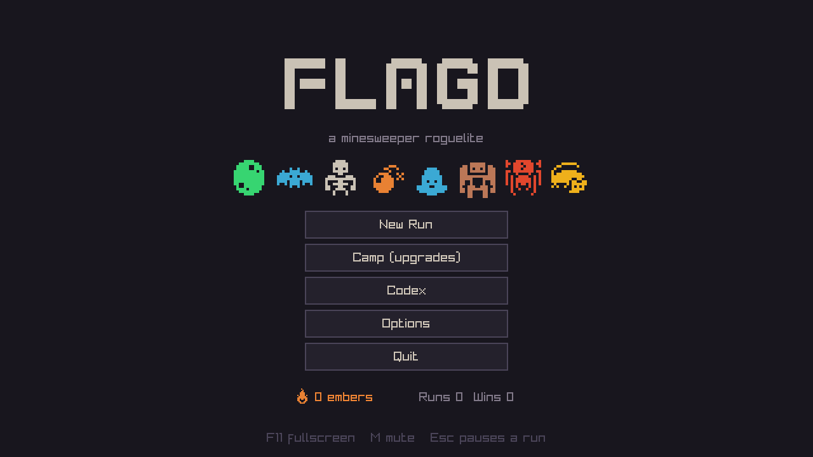

| | |
|---|---|
| 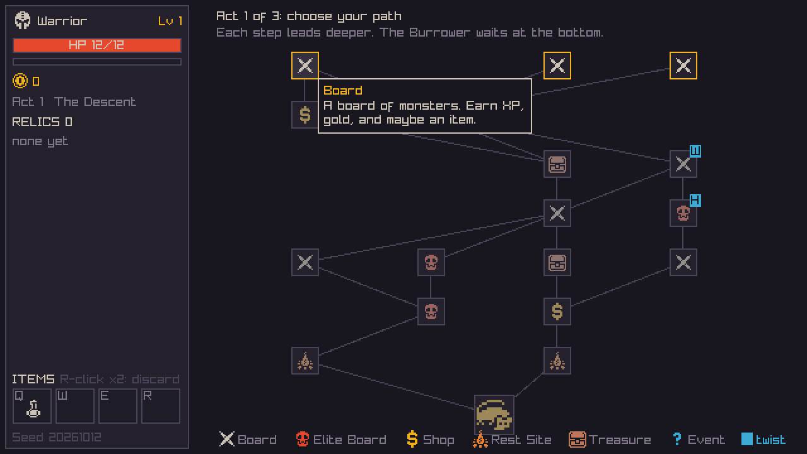 | 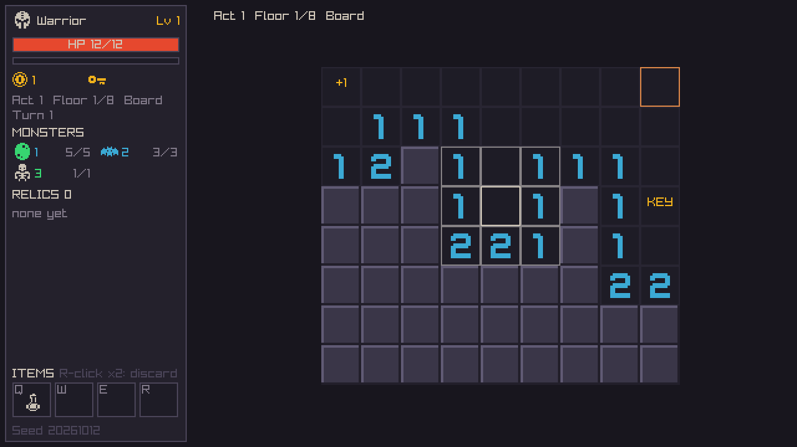 |
| *Slay-the-Spire-style map: boards, elites, shops, rests, treasure, events* | *Threat numbers: each counts the total power around it* |
| 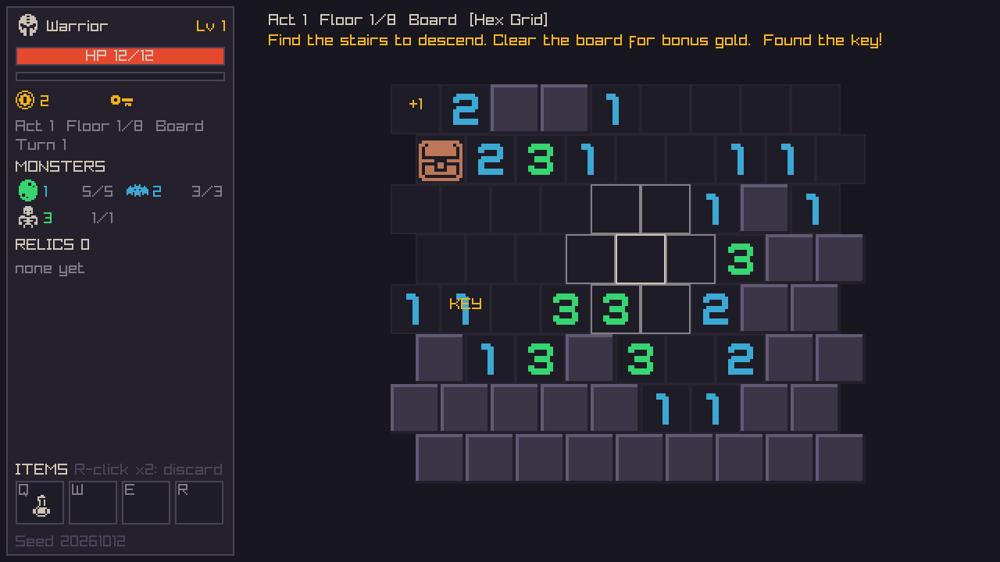 | 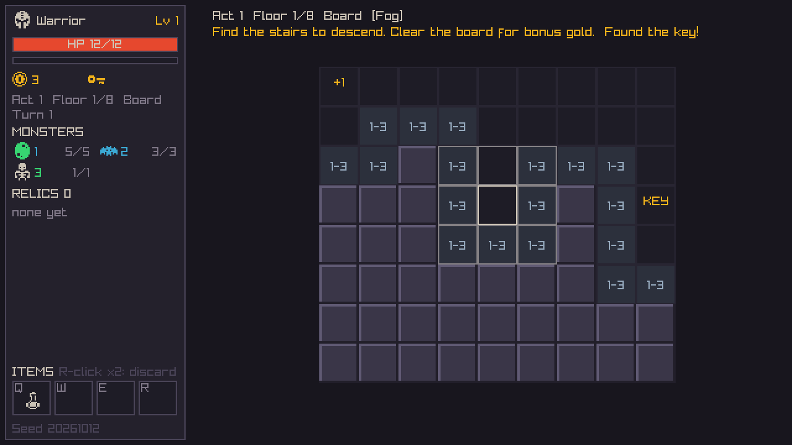 |
| *Hex grid twist: six neighbours per tile* | *Fog twist: numbers show only a range* |
| 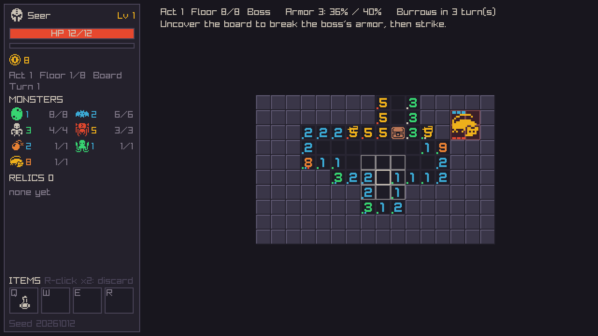 | 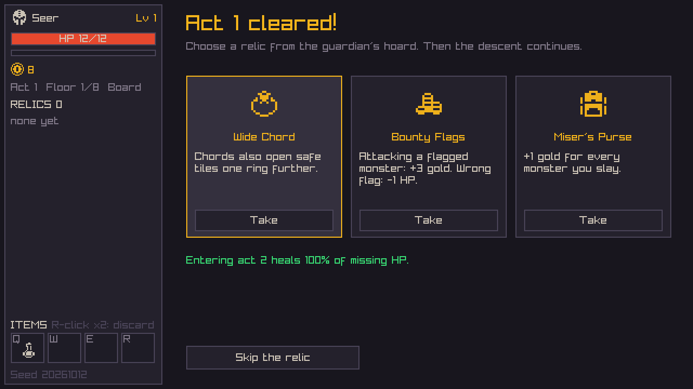 |
| *Bosses wear armor (blue pips) that breaks as you uncover the board* | *Each act's boss drops a relic choice* |
| 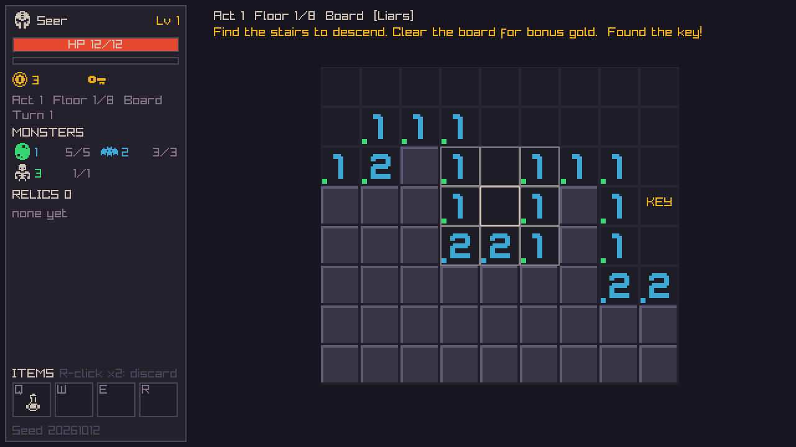 | 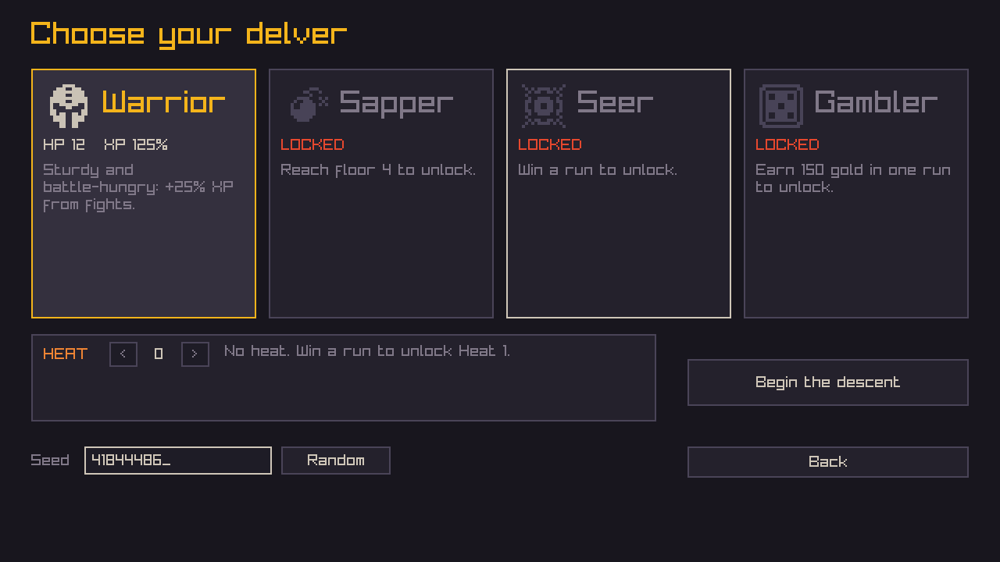 |
| *The Seer's pips show which monsters lurk near each number* | *Four classes and opt-in heat* |
| 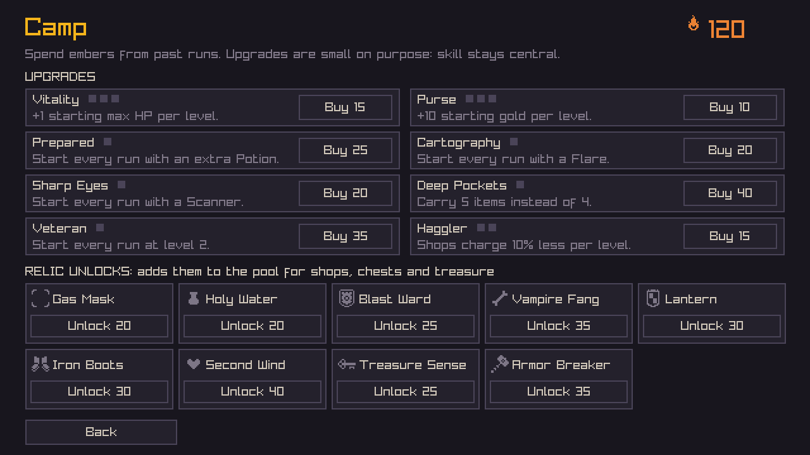 | 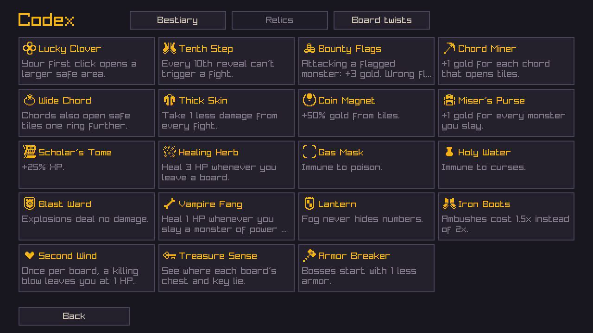 |
| *Spend embers on permanent upgrades and relic unlocks* | *The Codex records what you've found* |
| 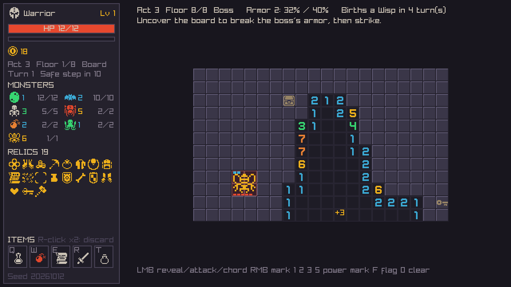 | 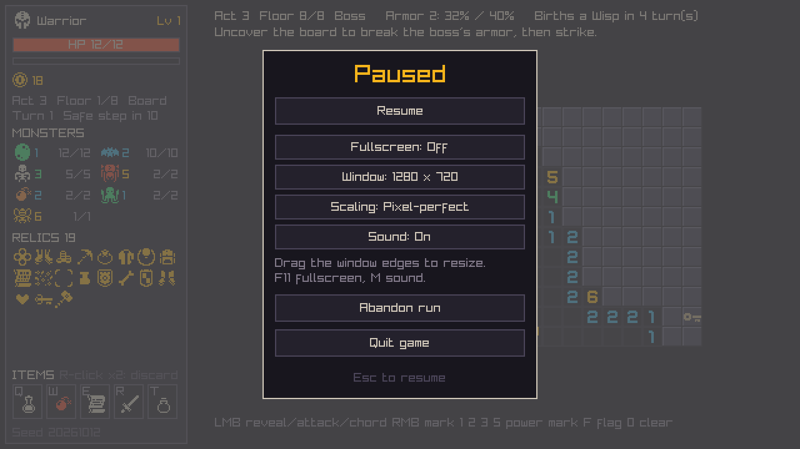 |
| *Boss arenas grow each act (act 3: 20×12)* | *Pause menu with display and sound options* |

## Build (Windows, MSYS2 UCRT64)

```bash
pacman -S --needed mingw-w64-ucrt-x86_64-gcc mingw-w64-ucrt-x86_64-cmake mingw-w64-ucrt-x86_64-ninja
cmake -S . -B build -G Ninja -DCMAKE_BUILD_TYPE=Release
cmake --build build
./build/flagd.exe
```

The first configure downloads raylib 5.5 and doctest. The build copies the sprite sheet to `build/assets/sheet.png`.

Progress and settings are saved to `%APPDATA%\Flagd\save.txt` when a run ends, when you buy at the Camp, and when you change settings. A run in progress is not saved.

Tests:

```bash
ctest --test-dir build --output-on-failure
./build/flagd_tests.exe --no-skip -tc="stress*"            # 7,000 boards, every floor and twist
./build/flagd_tests.exe --no-skip -tc="autoplay: every*"   # bot win rate per class and boss
```

## Controls

| Input | Action |
|---|---|
| Left click | Reveal a tile, attack a monster, chord a number, open a chest, take the stairs |
| Right click | Cycle marks: flag, P1, P2, P3, P5, none |
| `1` `2` `3` `5` / `F` / `0` | Set a power mark, a flag, or clear the mark on the hovered tile |
| Middle click / `Space` | Same as left click on the hovered tile |
| `Q` `W` `E` `R` (`T`) | Use or select an item. With Deep Pockets you get a fifth slot. |
| Click an item slot | Use it. Potion, Elixir, Shield and Whetstone also work on the map and in rooms. |
| Right-click an item slot twice | Discard the item |
| `Esc` | Cancel the selected item, or pause (resume, options, abandon run, quit) |
| `F11` / `M` | Fullscreen / sound |

**Options** (title screen or pause menu):
- Fullscreen
- Window size: 960×540 up to 1920×1080. You can also drag the window edges.
- Scaling: pixel-perfect whole steps, or fill the window
- Sound

All settings are saved.

Hover over a number to see what is already accounted for. Its neighbours are outlined, which helps on hex and wrap-around boards.

## Rules in short

- **Threat numbers:** each number is the sum of the power of the living monsters next to that tile. When a monster dies, the numbers around it drop.
- **Fights:**
  - Attacking a monster costs its power in HP and gives XP. That's the *prepared* cost.
  - You get the prepared cost only for a monster you can see, or one you **marked where the numbers prove a monster must be**.
  - Anything else is an **ambush** and costs double. That includes clicking an unmarked monster, and marking a random tile on a hunch and clicking it.
- **Level ups** raise max HP and heal you. Time your big fights for just before one.
- **Chords:** click a number whose marks and visible monsters add up exactly, and its other neighbours open.

### Monsters

| Monster | Power | Twist |
|---|---|---|
| Slime, Bat, Skeleton, Spider | 1, 2, 3, 5 | none |
| Powder Keg | 2 | Unmarked, it explodes for 4 damage and exposes everything around it. Marked, it defuses for 1. |
| Plague Polyp | 1 | Ambush poisons you: 1 HP per turn for 3 turns. |
| Cursed Idol | 2 | Ambush curses the board: XP is halved. |
| Sleeping Golem | 3 | Free to slay once nothing around it is hidden. |
| Wisp | 2 | Always visible. It drifts one tile per turn, lighting its trail, and the numbers shift with it. |

### Acts and bosses

A run is **three acts**, each with its own map and boss. Each boss appears once per run, in seeded order:
- **Burrower:** buries a revealed number every 4 turns.
- **Fog Wyrm:** every number is fogged into a range. Each hit clears the air around it.
- **Hive Mother:** births a Wisp every 5 turns.

Boss arenas are big and grow each act: 16×10, then 18×11, then 20×12. Bosses start with **3 armor** and can't be hurt until it's gone. One point breaks when you've uncovered 40%, 70% and 95% of the board's safe tiles, so you have to clear the board before you can strike. Bosses gain an extra hit in each later act.

Beating a boss offers a choice of 3 relics. Then the next act begins, with harder and denser boards, and you heal (full heal, or half at heat 3+).

### Classes

| Class | HP | XP | Ability | Unlock |
|---|---|---|---|---|
| Warrior | 12 | 125% | Plain and sturdy | Start |
| Sapper | 11 | 110% | 2 Defusers; explosions half damage; kegs defuse free | Reach floor 4 |
| Seer | 10 | 130% | Coloured pips show which kinds lurk around each number; starts with a Scanner | Win a run |
| Gambler | 11 | 115% | Unproven reveals that turn out safe heal 1 HP; ambushes cost triple | Earn 150 gold in a run |

### Items, relics, upgrades

- **9 items:**
  - Scanner, Defuser, Flare, Shield, Potion
  - **Bomb:** clears a 3×3 area, monsters included.
  - **Elixir:** +2 max HP.
  - **Compass:** shows the stairs and key.
  - **Whetstone:** your next 3 attacks cost 1 less HP.
- **19 relics.** Ten are in the pool from the start. Nine more are unlocked with embers at the Camp, including:
  - **Iron Boots:** ambushes cost 1.5×.
  - **Second Wind:** survive one killing blow per board.
  - **Armor Breaker:** bosses start with 2 armor.
- **8 permanent upgrades** at the Camp. They're kept small on purpose:
  - +max HP, +gold
  - A starting Potion, Flare or Scanner
  - A fifth item slot
  - Start at level 2
  - Cheaper shops

### Board twists

Twists show as a blue badge on the map. From act 2 they can appear on any floor, and every map has at least two. The first time you meet a twist, a popup explains it.
- **Wrap-around:** the edges connect.
- **Hex grid:** six neighbours per tile.
- **Fog:** numbers show a range, like 4-6.
- **Liars:** purple numbers are off by 1 or 2 and should be ignored.

### Economy

Gold is scarce on purpose:
- Gold tiles are rare. Tiles next to more danger are likelier to hold gold and pay more.
- Clearing a board and opening its chest give small bonuses.
- Shop prices rise each act.

A careful player can usually afford about one relic, or a couple of items, per shop. Not the whole stock.

### Meta

- **Heat 1–5:** opt-in difficulty, unlocked one level per win, with +15% embers per level.
- **Embers:** earned per floor, kill and boss. Spent at the **Camp**.
- **Codex:** records every monster, relic and twist you've met.

## Layout

- `src/core/` holds the game rules and depends on nothing but the standard library:
  - `board`: cells, topologies (square, wrap, hex), threat sums, fog and liar views, and flood fill.
  - `solver`: sound deduction over threat sums, in two stages: cheap local windows, then exact components combined against the floor census. It also decides which marked attacks count as proven.
  - `boardgen`: places a board, simulates no-guess play, retries layouts, and adds hint tiles if needed.
  - `game_state`: `applyAction()` turns an action into events. All board rules live here.
  - `map` / `run`: maps, acts, shops, rest sites, treasure and events.
  - `meta`: embers, unlocks, upgrades, codex, settings, and plain-text save files.
  - `content/`: the data tables. `balance.h` holds every tunable number.
- `src/game/` is the raylib layer: a 640×360 canvas scaled up in whole steps, the screens, and synthesized sound effects (`audio.cpp`, no audio files).
- `tests/` covers unit tests, a brute-force solver soundness check over every topology, fog and liars, and autoplay bots for balance.

The screenshots above come from `flagd.exe --shots docs/screenshots`, a scripted tour that saves every screen at 2× and never touches your save file.

## Art

[Kenney 1-Bit Pack](https://kenney.nl/assets/1-bit-pack) (CC0). The monochrome sheet is tinted in code.
